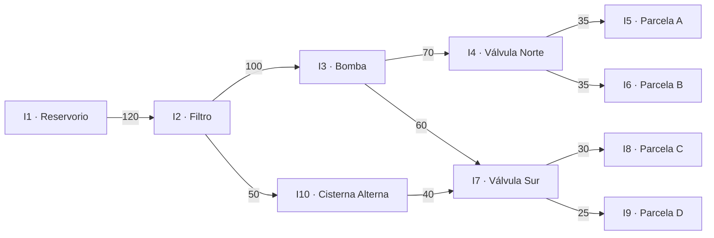
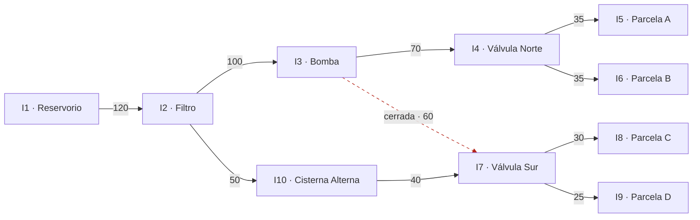
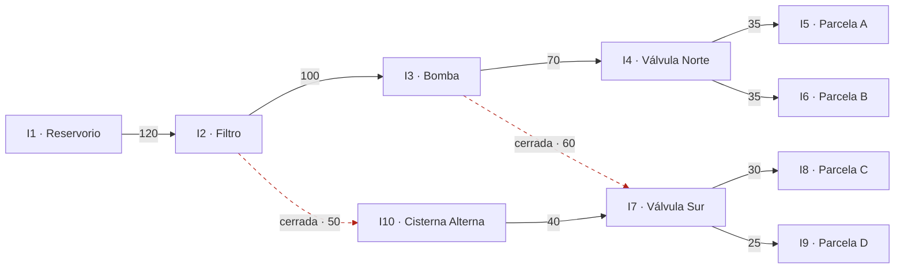
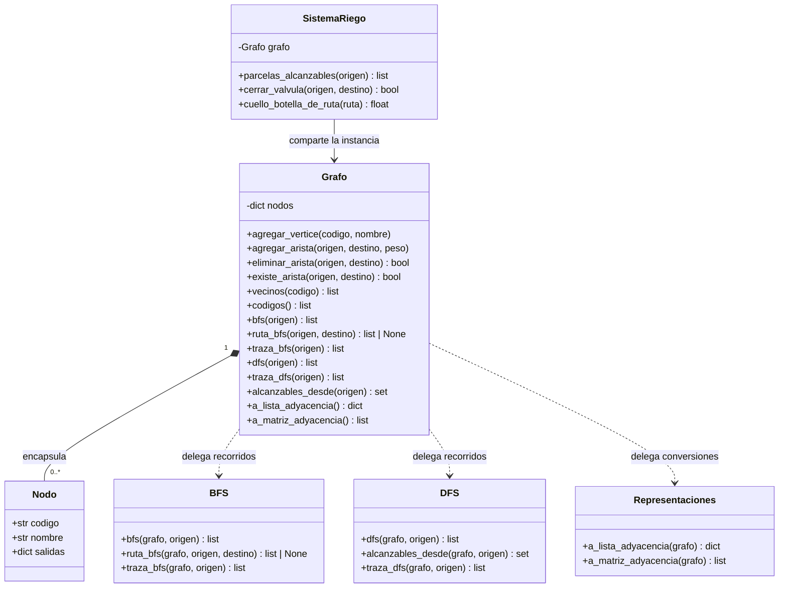

# Diagramas de la red de riego

Los diagramas se basan en el dataset de `datos.py`. Las etiquetas de las aristas son capacidades nominales en L/min. En los estados modificados, las flechas rojas discontinuas identifican las conexiones que se cerraron; no forman parte de las rutas disponibles.

## Red original

## Después de cerrar I3 → I7

La ruta a I9 usa el desvío por I10.

## Después de cerrar también I2 → I10

I9 permanece en la red, pero ya no es alcanzable desde I1. Las parcelas I5 e I6 siguen conectadas.

## UML de clases y colaboración

`SistemaRiego` recibe la instancia de `Grafo` y opera sobre ella sin hacer una copia. Las eliminaciones de aristas quedan visibles de inmediato en BFS, DFS y las representaciones que consultan esa misma instancia.

## Una celda y su entrada correspondiente

En la matriz original, la fila `I2` y columna `I10` contiene `50`. La misma conexión aparece en la lista de `I2` como `("I10", 50)`. El valor cero en esa celda tras cerrar la conexión indica que dejó de existir; `I10` continúa en la lista como vértice, aunque ya no figure como vecino de `I2`.
